<div align="center">

# FastAPI Supabase Starter

### Ship your SaaS on FastAPI + Supabase with auth, teams, roles, payments and AI already built.

The Python-first SaaS starter: a fork of Tiangolo's Full-Stack FastAPI Template, rebuilt on Supabase Auth and Postgres Row Level Security.

**FastAPI · Supabase · Postgres RLS · React 19 · TanStack · shadcn/ui · Stripe · Razorpay · Gemini · MCP**

**[Get it from ₹1,999 →](https://starter.budeglobal.in/#pricing)** · [See pricing](#pricing) · [On Product Hunt](https://www.producthunt.com/products/fastapi-supabase-starter)

One-time payment · Full source code · Unlimited projects

<br />

<a href="#see-it">
  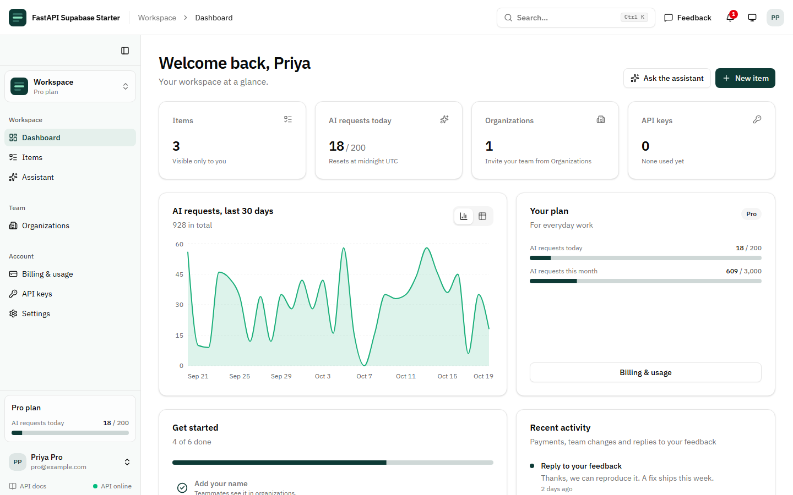
</a>

</div>

---

## You want to build your product. Not this.

Every SaaS needs the same foundation before its first real feature:

- **Sign-in:** password, codes, Google, reset emails, CAPTCHA
- **Teams:** organizations, invitations, member roles
- **Permissions:** admins, editors, viewers, and rules that hold up
- **Developer access:** API keys
- **Your brand:** name, logo and colors, changed without a deploy
- **Getting paid:** checkout, webhooks, receipts
- **AI:** an assistant, and lately an MCP server so Claude can use your app
- **Data isolation:** making sure user A can never see user B's rows

It's weeks of careful work before anything you can sell, and the security parts are where shortcuts hurt most.

**FastAPI Supabase Starter is that foundation, finished, tested and documented.** Clone it, add your keys, and spend day one on the feature your customers pay for.

## What it saves you

Rough estimates for an experienced developer building each piece properly, tests included:

| Piece | Build it yourself | In the starter |
|---|---|---|
| App shell: sidebar, Ctrl+K command menu, dashboard, data tables, landing page | 4–6 days | ✅ |
| Supabase auth bridge (JWT/JWKS checks, session refresh, protected routes) | 1–2 days | ✅ |
| Email codes, phone codes (SMS/WhatsApp), social login, CAPTCHA, account security | 2–4 days | ✅ |
| "Runs as the user" data layer so RLS protects every request | 2–3 days | ✅ |
| Roles & permissions with admin UI, expiry and overrides | 3–5 days | ✅ |
| Plans, usage limits and an audit log | 2–3 days | ✅ |
| Admin: analytics, user management, impersonation, payments, feedback inbox | 4–5 days | ✅ |
| In-app notifications (live), dark mode | 1–2 days | ✅ |
| Organizations, invitations, ownership transfer | 3–5 days | ✅ |
| API keys | 1–2 days | ✅ |
| White-label branding: name, logo and colors from the admin UI | 1–2 days | ✅ |
| Rate limiting, request logs, a database health check, a Postman collection | 1–2 days | ✅ |
| Stripe + Razorpay with verified webhooks | 3–4 days | ✅ |
| AI assistant + MCP server with OAuth | 3–5 days | ✅ |
| AGENTS.md, Claude Code skills and MCP configs for coding agents | 1–2 days | ✅ |
| Public site for search engines: pre-built pages, blog, help center, legal pages, sitemap | 2–4 days | ✅ |
| API tests against a real Supabase + CI | 2–3 days | ✅ |
| **Total** | **7–12 weeks** | **An afternoon of setup** |

At even ₹2,000 an hour, the low end is about **₹5 lakh of work**, for **₹1,999**.

## What's inside

**🧭 A real app shell, not a demo page**
- Sidebar with grouped navigation, filtered by each user's permissions; collapses to icons (Ctrl+B) and becomes a sheet on phones
- Header with a **Ctrl+K command menu**, notifications, feedback, theme and account menu; breadcrumbs above each page title
- A dashboard home: KPI tiles, usage meters, an AI usage chart, a getting-started checklist and recent activity
- Data tables with search, sorting, column picker and paging; charts with a table view; confirm dialogs, toasts, skeletons and empty states everywhere
- A split-screen sign-in page

**🌐 A public site built for search engines**
- Home, features, pricing, compare, FAQ and contact pages, rendered to HTML at build time with TanStack Start; the signed-in app stays a fast single-page app
- A **blog** and a searchable **help center** written in Markdown, plus privacy, terms, refund and delivery pages (the ones Razorpay asks for)
- Per-page titles, descriptions, canonical links and link previews, structured data (product, FAQ, articles), `sitemap.xml` and `robots.txt`
- Still plain static files: any static host or nginx serves it

**🔐 Authentication (Supabase Auth)**
- Email + password, email codes, and phone codes over **SMS or WhatsApp** (via MSG91)
- Any OAuth provider (Google, GitHub, Apple, …), configured with one env var
- Password reset, auto-refreshing sessions, Cloudflare Turnstile CAPTCHA
- A Security page in settings: change email or password, and sign out every other device

**🛡️ Security built into the database**
- Postgres **Row Level Security** on every table
- The API runs each request **as the signed-in user**, whether the caller uses the web app, an API key or Claude over MCP
- No direct database connection and no hand-written ownership checks to forget: the API calls Supabase with the caller's own token. The secret key is used only for server-side work (verified webhooks, recording payments, resolving API keys)

**👥 Teams, roles and permissions**
- Organizations with owner, admin and member roles, email or link invitations, and ownership transfer
- A role × resource × read/create/update/delete matrix, editable under Admin › Roles & permissions
- Expiring role assignments and per-user allow/deny overrides
- One SQL `has_permission()` used by RLS, the API and the UI

<p align="center">
  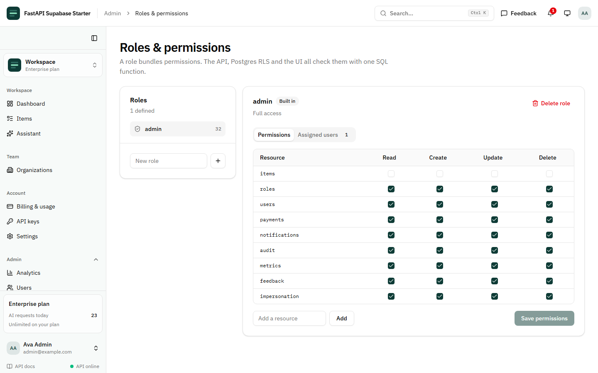
</p>

**🔑 API keys**
- Personal keys: hashed, shown once, optional expiry
- Calls made with a key are protected by the same RLS rules

**💳 Plans and payments in USD and INR**
- **Stripe** Checkout and **Razorpay** (UPI, cards, netbanking)
- Signature-verified webhooks are the only thing that can mark a payment paid, and each event is applied exactly once
- Free / Pro / Enterprise plans with daily and monthly limits per feature, upgraded automatically on payment
- Server-side price list, payment history page

<p align="center">
  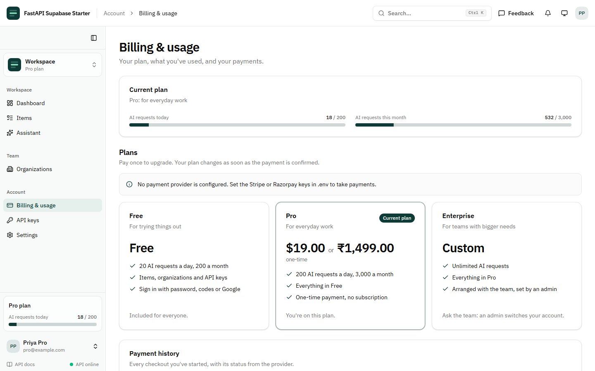
</p>

**🤖 AI-native**
- A **Gemini** assistant with tool calling, saved conversations, and per-plan usage limits
- The same tools served as an **MCP server**, so Claude, Cursor and other AI clients can connect with Supabase OAuth (or an API key) and act on your app as the user, never beyond their data
- Tools out of the box: list and search items, create items, read the account (plan and usage) and organizations

**🧠 Ready for AI coding agents**
- `AGENTS.md` with the security rules, commands, layout and recipes, read by Codex, Cursor, Copilot, Windsurf and Claude Code
- `CLAUDE.md` plus Claude Code skills: `/add-resource` (migration with RLS, API, tests, client, page, nav) and `/add-ai-tool`
- `ADD_PRODUCT.md`: one prompt for any agent to add a whole product area, with related tables, pages, a permission and AI tools
- MCP servers preconfigured for Claude Code (`.mcp.json`), Cursor (`.cursor/mcp.json`) and Codex (`.codex/config.toml`): Supabase in read-only mode, shadcn/ui, Playwright and the app's own server
- `.gemini/settings.json` points Gemini CLI at the same `AGENTS.md`
- Each tool's docs: [Claude Code MCP](https://code.claude.com/docs/en/mcp) and [memory](https://code.claude.com/docs/en/memory), [Codex MCP](https://learn.chatgpt.com/docs/extend/mcp?surface=cli), [Cursor MCP](https://cursor.com/docs/context/mcp), [VS Code MCP servers](https://code.visualstudio.com/docs/copilot/customization/mcp-servers), [Gemini CLI context files](https://geminicli.com/docs/cli/gemini-md), [Supabase MCP](https://supabase.com/docs/guides/getting-started/mcp), [shadcn MCP](https://ui.shadcn.com/docs/mcp), and [which tools read AGENTS.md](https://thepromptshelf.dev/blog/agents-md-vs-claude-md-tool-support-2026)

<p align="center">
  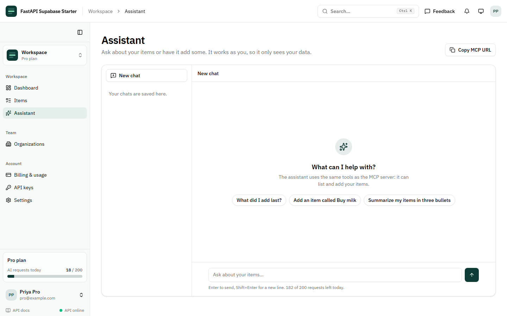
</p>

**🛠️ Admin and support**
- An admin console with its own pages: Analytics, Users, Payments, Roles & permissions, Messaging, Feedback and Audit log
- Analytics: KPI tiles plus daily charts of sign-ups, AI requests, messages sent and failed, and revenue per currency
- User management: details, ban / unban, delete, change plan, per-user permission overrides
- **User impersonation** for support, with a "viewing as" banner; admins can't be impersonated
- Feedback and bug reports from inside the app, with an admin inbox and replies
- Every admin action in the audit log, with a before/after view of each change

<p align="center">
  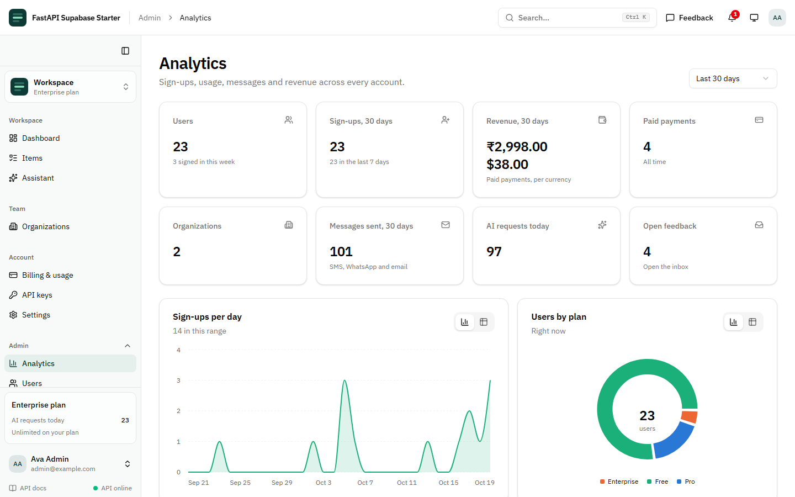
</p>

**🎨 Your brand, without a deploy**
- Admins set the app's **name, logo and color** under Settings › Appearance; the header, sidebar, sign-in page and browser tab follow
- Eight curated palettes or any custom color, with **five chart colors derived from it** automatically
- Dark mode handled: the color is lifted for dark backgrounds and button text picks white or dark for contrast
- Changes preview for the admin first, then apply to everyone; each one lands in the audit log

<p align="center">
  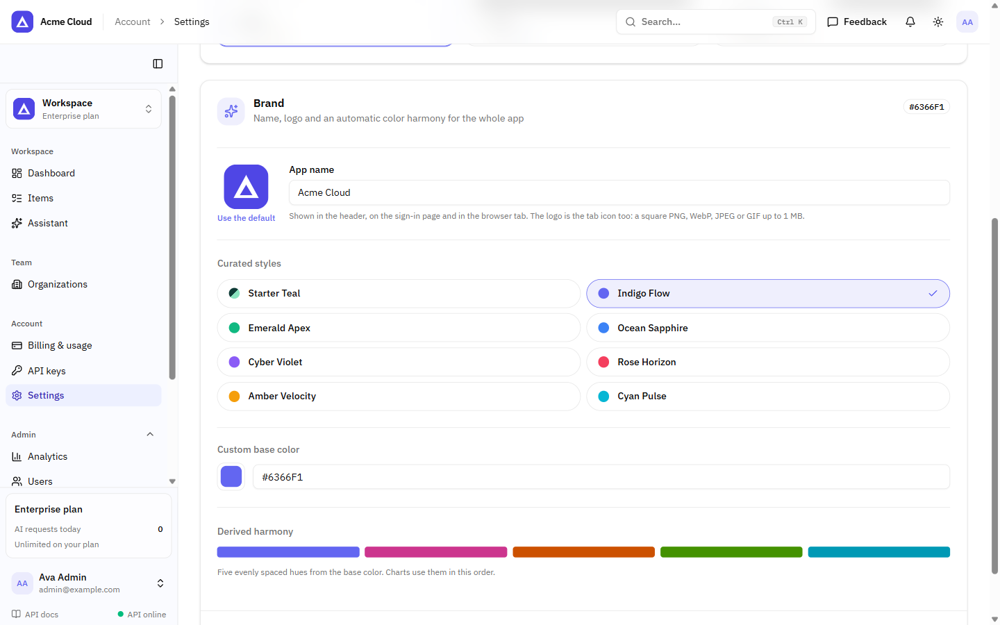
</p>

**⚙️ Operations**
- A per-IP **rate limit** that answers 429 with Retry-After (payment webhooks exempt), tunable or off with one env var
- One log line per request with status, timing and the real client IP behind a proxy
- `/health` checks the database through Supabase, ready for uptime monitors
- A **Postman collection** generated from the API alongside the typed client

**🔔 Notifications**
- In-app notifications with an unread badge, delivered live through Supabase Realtime
- Built-in triggers: payment received, new organization member, reply to feedback; `notify()` for your own events

**🧰 Everything around it**
- Dark mode (light / dark / system), designed rather than inverted
- Profiles with avatar uploads (Supabase Storage)
- An audit log written by database triggers: every change to roles, permissions, members, API keys, payments and plans, with who made it
- SMS, WhatsApp (MSG91) and email (SMTP) templates managed under Admin › Messaging, with a delivery log of every message
- Sentry, CORS config, Docker Compose, GitHub Actions
- A typed TypeScript client generated from your OpenAPI schema, with React 19, TanStack Start, Router and Query, and shadcn/ui
- Pages: home, features, pricing, compare, FAQ, contact, blog, help center, legal, sign-in, dashboard, items, organizations (members, invitations, settings), billing, assistant, API keys, settings (profile, security, appearance and brand, your feedback), the admin console and OAuth consent
- `scripts/seed_demo.py`: demo accounts and 60 days of history, so the charts have something to show on day one

Each integration switches on when its keys are set in `.env`. Payments, messaging and AI each live in their own migration and router, so they're easy to delete if you don't need them.

## See it

<table>
  <tr>
    <td width="50%">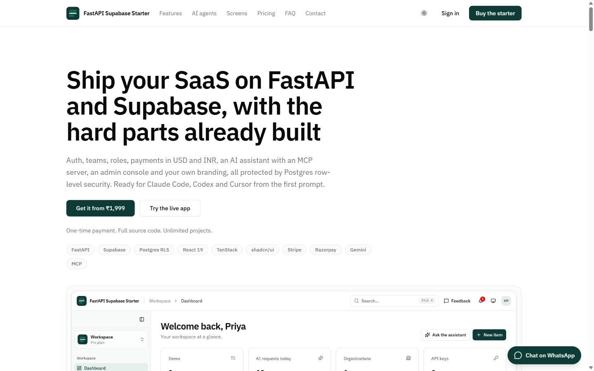<br /><sub>The sales page: features, screenshots, rupee pricing and WhatsApp checkout</sub></td>
    <td width="50%">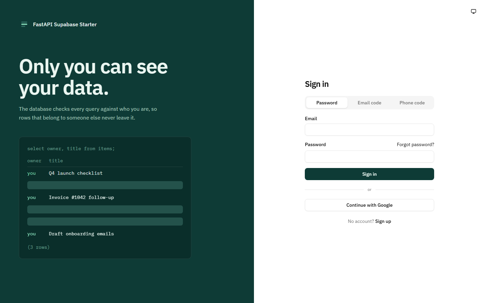<br /><sub>Sign in with a password, a code or Google</sub></td>
  </tr>
  <tr>
    <td>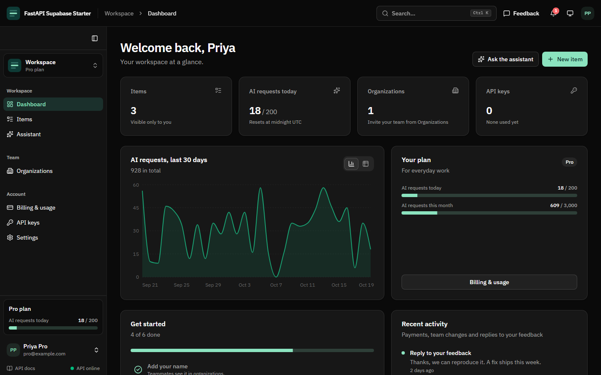<br /><sub>Dark mode, designed rather than inverted</sub></td>
    <td>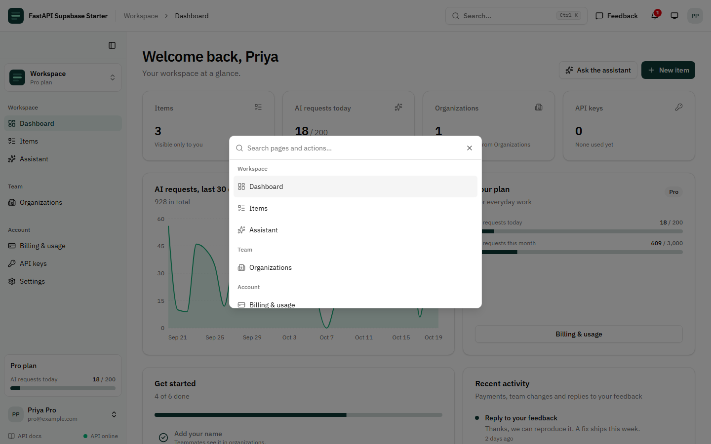<br /><sub>Ctrl+K: jump to any page or action</sub></td>
  </tr>
  <tr>
    <td>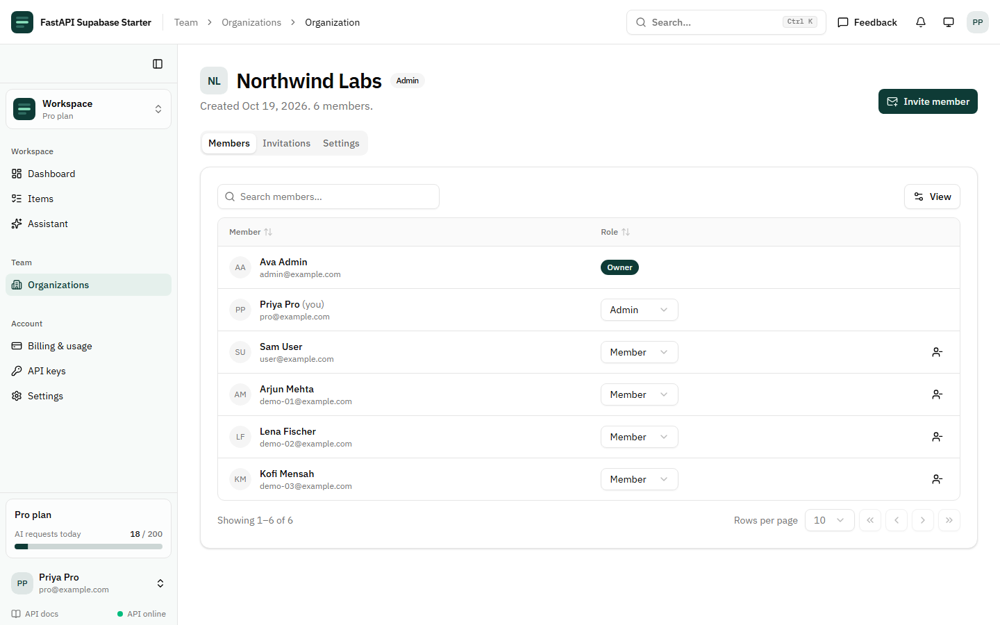<br /><sub>Organizations: members, roles and invitations</sub></td>
    <td>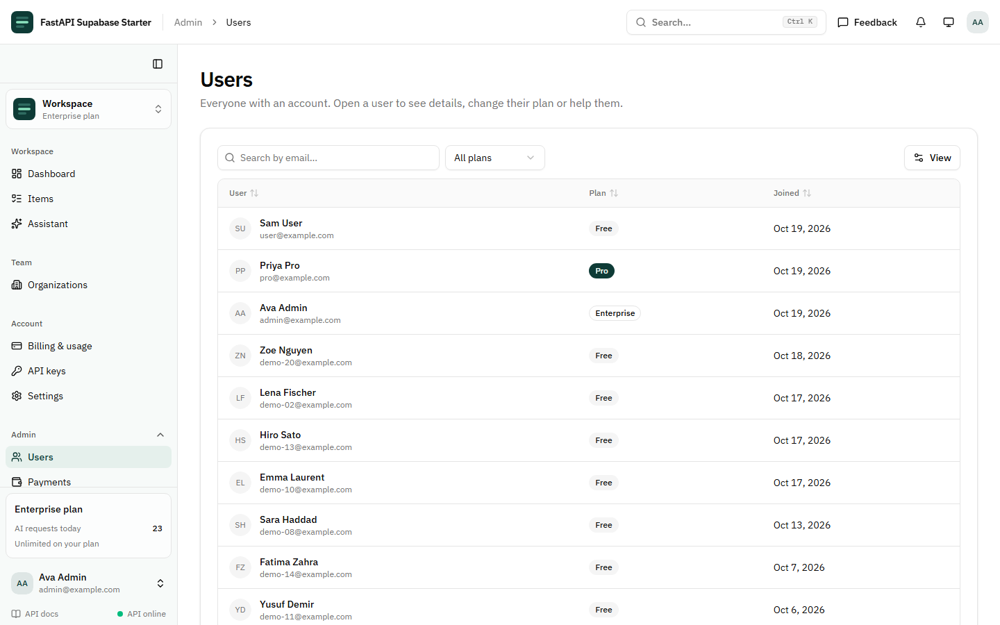<br /><sub>Admin: every user, searchable, one click to details</sub></td>
  </tr>
  <tr>
    <td>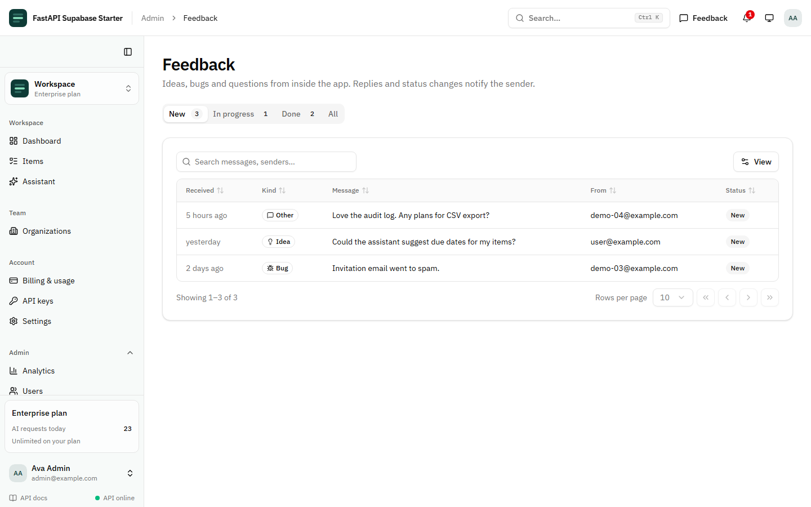<br /><sub>Admin: a feedback inbox; replies notify the sender</sub></td>
    <td>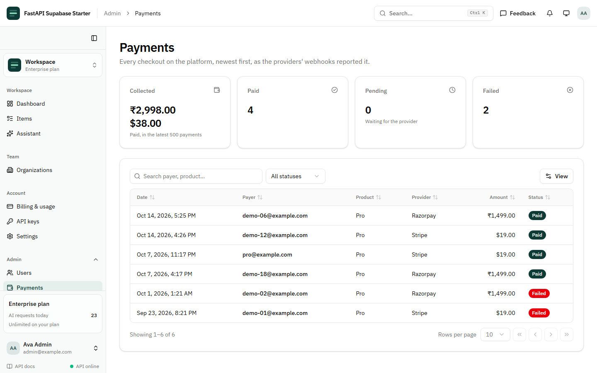<br /><sub>Admin: payments per currency, as the webhooks reported them</sub></td>
  </tr>
  <tr>
    <td colspan="2" align="center">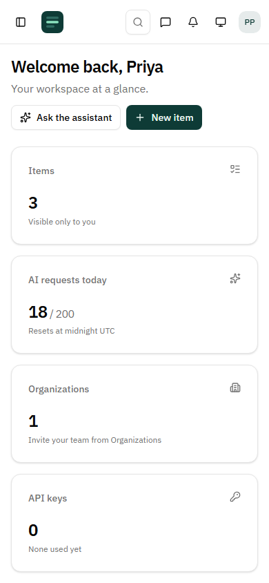 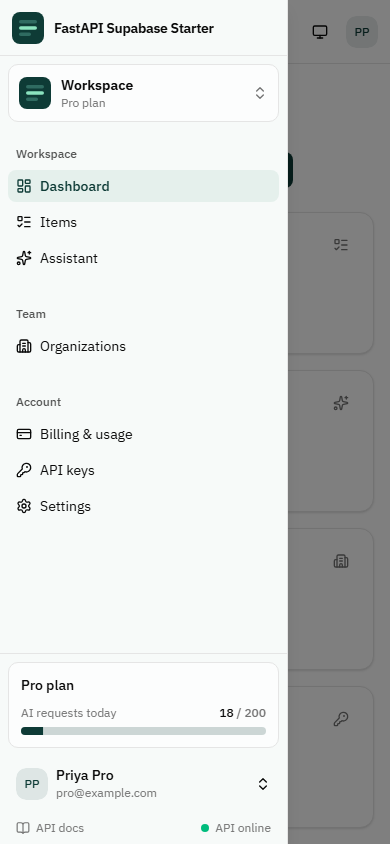<br /><sub>On a phone: the sidebar becomes a sheet</sub></td>
  </tr>
</table>

## Why this one

**1. Python backend, Supabase superpowers.** Most Supabase starters are Next.js-only. This one keeps FastAPI and Pydantic for your business logic, data work and AI, and lets Supabase handle auth, storage and the database.

**2. RLS that covers every caller.** Many starters enable RLS and then query with an admin key from the server. Here, web sessions, API keys and MCP clients all run as the user in Postgres. The isolation is tested end to end in CI against real Postgres and your actual migrations.

**3. Ready for AI clients and AI coding agents.** Your app ships with an MCP server and Supabase OAuth sign-in, so "connect our app to Claude" is already done. And the repo ships `AGENTS.md`, Claude Code skills and MCP configs, so Claude Code, Codex and Cursor build features the way the starter expects.

**4. Built for global and Indian SaaS.** Stripe for international cards and Razorpay for UPI. MSG91 delivers phone codes over SMS or WhatsApp, the way Indian users expect to sign in.

**5. A foundation you'll recognize.** Same layout and spirit as Tiangolo's full-stack-fastapi-template, minus the auth code you'd otherwise maintain.

## Compared with the original template

| | full-stack-fastapi-template (free) | FastAPI Supabase Starter |
|---|---|---|
| Auth | Your own endpoints, password hashing, SMTP, Mailpit | Supabase Auth: no auth code to maintain |
| Login methods | Email + password | Password, email codes, SMS/WhatsApp codes, OAuth, CAPTCHA |
| Sessions | 8-day token in localStorage, no refresh | Short-lived JWT, auto-refreshed |
| Authorization | `owner_id` checks in each endpoint | Postgres RLS on every request |
| Roles | `is_superuser` flag | Permission matrix, expiry, overrides, admin UI |
| Teams | – | Organizations + invitations |
| API keys | – | ✅ |
| Payments | – | Stripe + Razorpay |
| Plans & limits | – | Free / Pro / Enterprise with per-feature limits |
| Audit log | – | Trigger-based, covers every access change |
| Admin tools | User list | User management, impersonation, metrics, feedback inbox |
| Notifications | – | In-app, live via Supabase Realtime |
| Branding | Edit the code | Name, logo and colors from the admin UI, charts included |
| Operations | A health-check endpoint | Rate limiting, request log, database health check, Postman collection |
| Dark mode | ✅ | ✅ |
| AI / MCP | – | Gemini assistant with history + MCP server |
| AI coding agents | – | AGENTS.md, Claude Code skills, MCP configs for Claude Code, Cursor and Codex |
| Database | Self-hosted Postgres, SQLModel, Alembic | Supabase Postgres, SQL migrations with RLS |
| Containers | Traefik, Postgres, Adminer, backend, Mailpit | backend, frontend |

The original is excellent and free. Pick it if you want to own auth yourself. Pick this if you'd rather ship.

## How it works

<p align="center">
  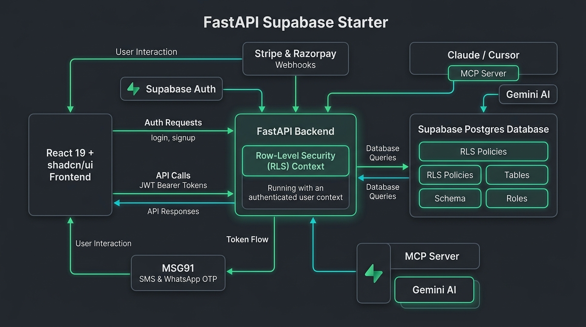
</p>

<details>
<summary><b>Click to view ASCII flow diagram</b></summary>

```text
 Browser                                       Supabase
+--------------------+  sign-in / OAuth / OTP  +-----------------------+
|  React + Vite      |------------------------>|  Supabase Auth        |
|  shadcn/ui         |<------------------------|  (+ OAuth 2.1 server  |
|  supabase-js       |      session (JWT)      |   for MCP clients)    |
+---------+----------+                         +-----------+-----------+
          |                                                | Send SMS hook
          | Authorization: Bearer <JWT>                    v
          v                                    +-----------------------+
+--------------------+                         |  FastAPI /hooks       |---> MSG91
|  FastAPI           |  Supabase REST API,     +-----------------------+
|  verifies JWT      |  with the user's token  +-----------------------+
|  or API key        |------------------------>|  Supabase Postgres    |
|  /mcp  /ai  /...   |  (RLS applies)          |  RLS: auth.uid(),     |
+----+---------+-----+                         |  has_permission(),    |
     ^         ^                               |  org_role()           |
     |         |                               +-----------------------+
     |   Stripe / Razorpay webhooks (signature-verified)
     |
 Claude, Cursor, scripts (OAuth token or sk_ API key)
```

</details>

Adding a protected endpoint is one parameter:

```python
@router.get("/reports", dependencies=[require_permission("reports", "read")])
def reports(db: UserDB) -> list[Report]:
    return db.table("reports").select("*").execute().data  # runs as the caller, so RLS applies
```

## Who it's for

- **Python developers** who want Supabase's auth and database without giving up FastAPI
- **Founders building B2B SaaS** who need teams, roles and API keys from day one
- **Agencies** that start a new client app every few weeks
- **Indian startups** that need Razorpay and SMS/WhatsApp login next to Stripe
- **Teams adding AI** who want their app usable from Claude and Cursor

**Probably not for you if** you want a JavaScript-only stack (pick a Next.js starter), you can't use Supabase, or you need subscription billing today (payments are one-time for now).

## Coming next

Planned for upcoming releases. These aren't in the code yet; they arrive as updates in the private repository, within your plan's update period.

- **Subscriptions:** monthly and yearly plans, per-seat billing for organizations, a customer portal and invoices
- **End-to-end tests:** Playwright tests that click through every page, run in CI
- **Multiple languages:** translated UI and emails, starting with Hindi and Tamil
- **Blog, docs and changelog:** pages written in Markdown, with a sitemap and social preview images
- **Background jobs:** queued emails, webhook retries and scheduled tasks
- **Onboarding:** a guided first-run flow for new accounts
- **Analytics:** product analytics and feature flags
- **Two-factor sign-in and passkeys:** authenticator apps on top of Supabase Auth's MFA
- **File uploads:** documents and images beyond avatars, stored in Supabase Storage
- **More payment providers:** Lemon Squeezy, Polar and Paddle next to Stripe and Razorpay
- **AI over your users' data:** answers grounded in each user's own records with pgvector, still behind RLS
- **Mobile app:** an Expo (React Native) app that uses the same API and Supabase sign-in
- **More for coding agents:** extra Claude Code skills and an `AGENTS.md` per folder

The list comes from comparing this starter with what others ship, according to their own pages:

- MakerKit: [boilerplate comparison](https://makerkit.dev/blog/saas/best-nextjs-saas-boilerplate), [AI agents setup](https://makerkit.dev/docs/tanstack-supabase/installation/ai-agents), [MCP server](https://makerkit.dev/blog/changelog/mcp-server)
- supastarter: [features](https://supastarter.dev/saas-boilerplate), [boilerplate comparison](https://supastarter.dev/best-saas-boilerplate-2026)
- TurboStarter: [starter kit comparison](https://www.turbostarter.dev/blog/best-saas-starter-kit-2026)
- StarterIndex: [FastAPI SaaS starters](https://starterindex.com/saas+fastapi-boilerplates)

Want one of these sooner? [Tell us on WhatsApp](https://wa.me/919361621891) or email [budemadeofficial@gmail.com](mailto:budemadeofficial@gmail.com).

## Pricing

One-time payment. No subscription. Full source code.

| | **Solo** | **Pro** ⭐ Most popular | **Team** |
|---|:---:|:---:|:---:|
| **Price** | **₹1,999** | **₹2,999** | **₹4,999** |
| Developers | 1 | 1 | Up to 5 |
| Full source code, every feature | ✅ | ✅ | ✅ |
| Unlimited projects, including client work | ✅ | ✅ | ✅ |
| Commercial use | ✅ | ✅ | ✅ |
| Free updates | 3 months | 12 months | Lifetime |
| Support | Email | Priority email | Priority email + 60-min onboarding call |

**[Buy now (UPI, cards, netbanking) →](https://starter.budeglobal.in/#pricing)**

Prices are in Indian rupees. Updates arrive through the private GitHub repository you're invited to after purchase. Paying from outside India? Message us.

**Questions, or want to buy right now?** WhatsApp or call [+91 93616 21891](https://wa.me/919361621891), or email [budemadeofficial@gmail.com](mailto:budemadeofficial@gmail.com).

## FAQ

**Is this a subscription?**
No. You pay once and keep the code forever. Free updates last 3 months on Solo, 12 months on Pro and for life on Team.

**Can I use it for client projects?**
Yes. Build unlimited apps for yourself or your clients and hand them the source. You just can't resell or republish the starter itself as a template. See [LICENSE](LICENSE).

**Can I put my own brand on it?**
Yes, without touching code: admins set the app's name, logo and color under Settings › Appearance, and every page, chart and the sign-in screen follow. For deeper changes, the design tokens live in one CSS file.

**Do I need a paid Supabase plan?**
No. You can build and test on Supabase's free tier, and you can run Supabase locally with the CLI. Check Supabase's pricing for your production needs.

**Do I have to use every integration?**
No. Payments, messaging, AI, email, CAPTCHA and Sentry stay off until you add their keys. Payments, messaging and AI each have their own migration and router, so they're easy to delete.

**I already use Tiangolo's template. Will this feel familiar?**
Yes: same FastAPI + React structure, same generated client. Note that existing users and passwords aren't migrated for you; Supabase Auth has its own user import options.

**Does it work with Claude Code, Codex and Cursor?**
Yes. `AGENTS.md` gives every coding agent the security rules, commands and recipes, and Claude Code also gets `CLAUDE.md` and two skills that build features end to end. MCP servers for Supabase (read-only), shadcn/ui and Playwright are preconfigured for Claude Code, Cursor and Codex, along with a server for the app itself.

**Which AI model does it use?**
Gemini, through the official SDK. The tools are plain Python functions, so moving them to another model's tool-calling API is a small change.

**How is it tested?**
Unit tests for token checks and webhook signatures, plus API tests that run against a real Supabase with the project's migrations. They cover data isolation between users, roles and overrides, organizations, API keys, payment webhooks, the SMS hook, the MCP server and branding. The rate limiter and request log have unit tests. CI runs the same suite.

**What versions does it use?**
Python 3.12, FastAPI, Supabase REST (postgrest-py), React 19, Vite, TanStack Start, Router and Query, Tailwind v4, shadcn/ui, Node 24.

## Quickstart

```bash
cp .env.example .env          # add your Supabase URL, publishable key and secret key
cat supabase/migrations/*.sql > supabase/setup.sql   # paste it into Supabase -> SQL Editor -> Run
docker compose up --build     # app on :5173, API on :8000
```

After purchase you're invited to the private repository. The full setup, feature and deployment guide (`docs/GUIDE.md`) ships with the code.

## License

Commercial license: see [LICENSE](LICENSE). This repository holds the docs only; the source code is in a private repository for license holders. Bug reports and feature requests are welcome: see [CONTRIBUTING.md](CONTRIBUTING.md), and report security issues privately as [SECURITY.md](SECURITY.md) describes. Includes code derived from MIT-licensed projects, with their notices reproduced in the LICENSE file.

Not affiliated with or endorsed by FastAPI, Sebastián Ramírez, Supabase, Stripe, Razorpay, MSG91 or Google.
